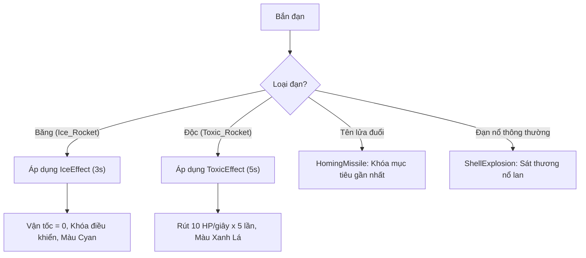
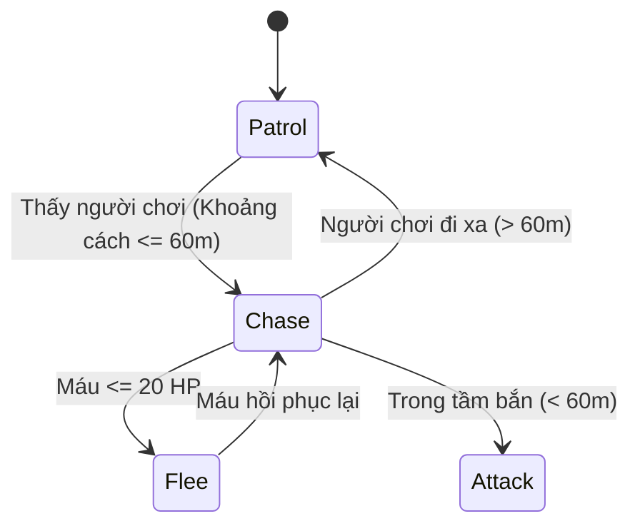
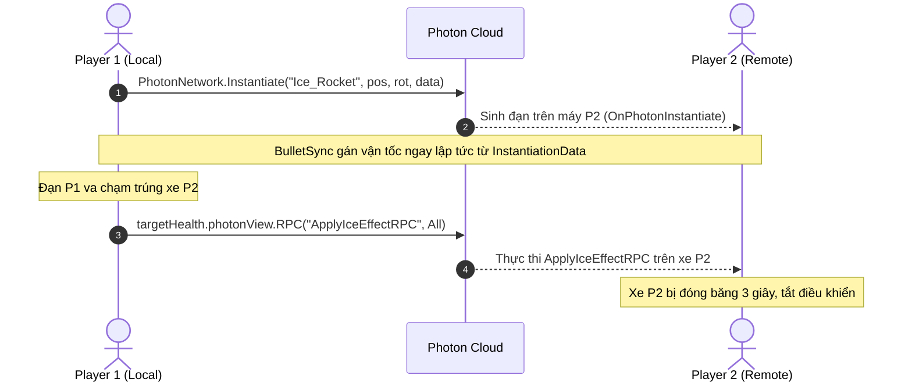

# TÀI LIỆU KỸ THUẬT VÀ THIẾT KẾ HỆ THỐNG GAME 3D TANK
*(System Architecture, Game Mechanics, Libraries & Networking Synchronization)*

---

## MỤC LỤC
1. [Tổng quan dự án & Môi trường phát triển](#1-tổng-quan-dự-án--môi-trường-phát-triển)
2. [Các thư viện & Frameworks sử dụng](#2-các-thư-viện--frameworks-sử-dụng)
3. [Cơ chế Game & Cách thức vận hành (Game Mechanics)](#3-cơ-chế-game--cách-thức-vận-hành-game-mechanics)
   - [Hệ thống Tank & Kỹ năng từng dòng xe](#hệ-thống-tank--kỹ-năng-từng-dòng-xe)
   - [Hệ thống Đạn dược & Hiệu ứng Nguyên tố](#hệ-thống-đạn-dược--hiệu-ứng-nguyên-tố)
   - [Hệ thống Vật phẩm (Item Drop & Pickup)](#hệ-thống-vật-phẩm-item-drop--pickup)
   - [Trí tuệ nhân tạo Bot AI (Chế độ Offline)](#trí-tuệ-nhân-tạo-bot-ai-chế-độ-offline)
4. [Kiến trúc Đồng bộ Mạng Online (PUN 2 Synchronization)](#4-kiến-trúc-đồng-bộ-mạng-online-pun-2-synchronization)
   - [Vòng đời kết nối phòng](#vòng-đời-kết-nối-phòng)
   - [Đồng bộ Di chuyển & Vị trí](#đồng-bộ-di-chuyển--vị-trí)
   - [Khởi tạo Đạn dược & Đồng bộ Vận tốc (InstantiationData)](#khởi-tạo-đạn-dược--đồng-bộ-vận-tốc-instantiationdata)
   - [Hệ thống RPC & Phân quyền chủ quyền (Ownership Authority)](#hệ-thống-rpc--phân-quyền-chủ-quyền-ownership-authority)
   - [Các giải pháp xử lý xung đột mạng thực chiến](#các-giải-pháp-xử-lý-xung-đột-mạng-thực-chiến)
5. [Cấu trúc Thư mục & Bảng ánh xạ Scripts quan trọng](#5-cấu-trúc-thư-mục--bảng-ánh-xạ-scripts-quan-trọng)

---

## 1. TỔNG QUAN DỰ ÁN & MÔI TRƯỜNG PHÁT TRIỂN

- **Tên dự án:** Game 3D Tank (Game_3D_Tank)
- **Engine:** Unity `2019.4.19f1` (C# .NET Standard 2.0)
- **Thể loại:** 3D Action Tank Shooter (PvE Chiến dịch theo đợt & PvP Đấu mạng nhiều người chơi)
- **Nền tảng hỗ trợ:** PC (Windows/Mac) & Mobile (Android/iOS)
- **Mô hình kiến trúc:** Client-Authoritative with Remote Validation via Photon Cloud

```
+-------------------------------------------------------------+
|                       GAME 3D TANK                          |
+------------------------------+------------------------------+
|       CHẾ ĐỘ OFFLINE         |        CHẾ ĐỘ ONLINE         |
|  - Quản lý: GameManager.cs   |  - Quản lý: NetworkManager   |
|  - AI: NavMeshAgent + FSM    |  - Phòng: GameManagerOnline  |
|  - Wave / Boss Progression   |  - Đồng bộ: PUN 2 Cloud     |
+------------------------------+------------------------------+
```

---

## 2. CÁC THƯ VIỆN & FRAMEWORKS SỬ DỤNG

| Thư viện / Plugin | Mục đích sử dụng | Vị trí trong dự án |
| :--- | :--- | :--- |
| **Photon Unity Networking 2 (PUN 2)** | Hệ thống mạng Multiplayer thời gian thực: Kết nối Master Server, Sảnh (Lobby), Tạo/Vào phòng, Đồng bộ Transform, RPC, `PhotonView`, `PhotonNetwork.Instantiate`. | `Assets/Photon/PhotonUnityNetworking` |
| **UnityEngine.AI (NavMesh)** | Hệ thống tìm đường (Pathfinding) cho Bot AI lính thường và Boss trong chế độ Offline (`NavMeshAgent`, `NavMesh.SamplePosition`, `NavMeshHit`). | Tích hợp sẵn trong Unity Engine |
| **Joystick Pack** | Điều khiển cần gạt ảo (Floating/Dynamic Joystick) dành cho nền tảng Mobile hoặc chuột trên PC. | `Assets/Joystick Pack` |
| **Cartoon FX (Legacy & Remaster)** | Hiệu ứng hình ảnh hạt (VFX Particles): Lửa nòng súng, khói mù, vụ nổ, khiên năng lượng, tia sét. | `Assets/JMO Assets/Cartoon FX*` |
| **WarFX** | Hiệu ứng âm thanh và hạt vụ nổ thực tế cho đạn đại bác và mìn. | `Assets/JMO Assets/WarFX` |
| **Unity UI & TextMeshPro** | Giao diện hiển thị: Thanh máu (World Space Slider), Nút kỹ năng (Skill Cooldown Fill Amount), Menu chọn xe. | `Assets/TextMesh Pro`, `UnityEngine.UI` |

---

## 3. CƠ CHẾ GAME & CÁCH THỨC VẬN HÀNH (GAME MECHANICS)

### Hệ thống Tank & Kỹ năng từng dòng xe
Trò chơi sở hữu 4 dòng xe chiến đấu riêng biệt, mỗi xe sở hữu bộ kỹ năng độc nhất trên 3 nút bấm:

| Xe | Vai trò | Đạn cơ bản | Nút 1 (Tấn công) | Nút 2 (Chiến thuật) | Nút 3 (Phòng thủ / Cơ động) |
| :--- | :--- | :--- | :--- | :--- | :--- |
| **Tank** | Cân bằng | `Shell` | **Spread Shot:** Bắn chùm 3 viên đạn tỏa hình nón góc 20°. | **Mine:** Thả mìn bẫy sát thương 50 sau lưng. | **Homing Missile:** Tên lửa tầm nhiệt tự khóa kẻ địch gần nhất. |
| **Tank 1** | Pháo kích | `Silver_Rocket` | **Giant Shell:** Phóng viên đạn khổng lồ kích thước x3, sát thương lớn. | **Turret (Machine Gun):** Đặt ụ súng máy tự động bắn địch trong tầm 40m. | **Clone (Decoy):** Lướt tới trước 12m và để lại phân thân đánh lạc hướng. |
| **Tank 2** | Nguyên tố | `Golden_Rocket` | **Elemental Shot:** Bắn luân phiên Đạn Băng (khóa cứng) và Đạn Độc (rút máu). | **Smoke:** Ném bom khói che khuất tầm nhìn trong 8s. | **Reflect Shield:** Kích hoạt khiên phản xạ mọi đạn bắn tới trong 5s. |
| **Tank 3** | Đột kích | `Shell` | **Death Spin:** Xoay tròn 360° bắn liên tục 8 phát đạn x 8 hướng trong 2s. | **Magnetic Pull:** Hút toàn bộ kẻ địch trong 15m về phía mình rồi kích nổ. | **Dash:** Tốc biến húc thẳng về phía trước gây sát thương và đẩy lùi. |

---

### Hệ thống Đạn dược & Hiệu ứng Nguyên tố



1. **Hiệu ứng Đóng Băng (`IceEffect.cs`):**
   - Triệt tiêu vận tốc ngay lập tức: `rb.velocity = Vector3.zero; rb.angularVelocity = Vector3.zero; rb.isKinematic = true;`.
   - Vô hiệu hóa script điều khiển: `movement.enabled = false`.
   - **Xử lý NavMesh:** Lưu cờ `wasAgentEnabled`. Khi hết đóng băng:
     - Xe Bot AI: Kích hoạt lại `agent.enabled = true`, dùng `NavMesh.SamplePosition` và `agent.Warp` định vị lại trên sàn và gọi `agent.isStopped = false`.
     - Xe Người chơi: Giữ nguyên `agent.enabled = false` để tránh xung đột vật lý với `Rigidbody`.
   - **Xử lý mạng:** Sau khi hết băng, `movement.enabled = true` chỉ mở cho máy chủ xe (`isMine`). Máy đối thủ giữ `enabled = false` để chống cướp quyền điều khiển.

2. **Hiệu ứng Nhiễm Độc (`ToxicEffect.cs`):**
   - Rút 10 máu mỗi giây trong 5 giây (`TakeDamage(10f)`).
   - Chỉ máy chủ sở hữu xe (`pv.IsMine`) trừ máu để tránh nhân đôi sát thương qua mạng.
   - Hỗ trợ làm mới thời gian độc (`RefreshToxic`) nếu dính tiếp đạn độc.

3. **Quản lý chuyển đổi màu xe thông minh (`TankHealth.cs`):**
   - Màu sắc gốc của xe (`m_OriginalColors`) được lưu trong `Awake()`.
   - Băng ưu tiên hiển thị màu **Xanh Băng** (`Color.cyan`), Độc hiển thị màu **Xanh Lá** (`Color.green`).
   - Khi hết hiệu ứng, kiểm tra xem còn hiệu ứng còn lại không; nếu hết sạch thì khôi phục 100% màu sơn gốc, không bao giờ bị dính màu vĩnh viễn.

4. **Khiên Phản Xạ (`ReflectShield.cs.cs`):**
   - Tạo trường bảo vệ bán kính ôm trọn thân xe.
   - Bất kỳ đạn nào chạm vào khiên sẽ bị đảo ngược vector vận tốc và góc quay (`velocity = -velocity; forward = -forward`).
   - Bật cờ `m_IsReflected = true` trên đạn nguyên tố để nếu đạn dội trúng lại người bắn, người bắn vẫn phải chịu hiệu ứng.

5. **Ụ súng máy tự động (`TurretAI.cs`):**
   - Nhận diện `m_OwnerTank` khi được đặt ra.
   - Tự xoay về xe địch gần nhất trong tầm 40m.
   - Sử dụng `Physics.IgnoreCollision` bỏ qua va chạm với xe người chơi, và gắn `m_ShooterTank` vào đạn nổ để người chơi không bao giờ bị mất máu do đạn của ụ súng mình đặt ra.

---

### Hệ thống Vật phẩm (Item Drop & Pickup)

Hệ thống xuất hiện định kỳ qua `MainItemSpawner.cs` và rơi ngẫu nhiên khi diệt xe địch qua `ItemDropSystem.cs`:

- **Medical (`Medical3D`):** Hồi 50 HP (hoặc tăng giới hạn máu nếu đầy).
- **ToolChest (`ToolChest3D`):** Tăng kích thước thân xe và phóng to đạn x1.5, tăng sát thương vụ nổ.
- **FuelTank (`FuelTank3D`):** Tăng 40% tốc độ di chuyển trong 10 giây.
- **Shield (`ReflectShield_Prefab`):** Kích hoạt khiên phản xạ trong 5 giây.

---

### Trí tuệ nhân tạo Bot AI (Chế độ Offline)

Bot trong chế độ PvE được điều khiển bởi máy trạng thái hữu hạn (FSM) tích hợp trong `TankMovement.cs` và `TankShooting.cs`:



- **Patrol (Tuần tra):** Chọn tọa độ ngẫu nhiên trong bán kính `patrolRadius = 35m` bằng `NavMesh.SamplePosition`.
- **Chase (Truy đuổi):** Cập nhật tọa độ người chơi liên tục vào `agent.SetDestination(playerTarget.position)`.
- **Flee (Bỏ chạy):** Khi máu dưới 20%, tính vector ngược hướng người chơi để chạy trốn.
- **Shooting AI:** Tự tính toán lực bắn theo khoảng cách:
  $$\text{launchForce} = \text{clamp}\left(\frac{\text{distance}}{\text{flightTime}}, 15, 30\right)$$
  Tự động sử dụng kỹ năng đặc thù của dòng xe mỗi chu kỳ hồi chiêu.

---

## 4. KIẾN TRÚC ĐỒNG BỘ MẠNG ONLINE (PUN 2 SYNCHRONIZATION)



---

### Vòng đời kết nối phòng

1. **Khởi tạo kết nối:** `PhotonNetwork.ConnectUsingSettings()` kết nối tới Photon Cloud.
2. **Vào sảnh:** `OnConnectedToMaster()` -> `PhotonNetwork.JoinLobby()`.
3. **Ghép phòng:** `JoinSharedRoom()` dùng `JoinOrCreateRoom("TankRoom_Global", roomOptions, TypedLobby.Default)`.
4. **Sinh xe người chơi:** Khi vào phòng thành công (`OnJoinedRoom`), gọi `PhotonNetwork.Instantiate(selectedTank, spawnPos, spawnRot)` dựa theo thông tin xe đã chọn trong `PlayerPrefs`.

---

### Đồng bộ Di chuyển & Vị trí

- Mỗi xe tăng chứa **`PhotonView`** và **`PhotonTransformView`**.
- `PhotonTransformView` theo dõi và nội suy (Interpolation) mượt mà vị trí `Position` và góc xoay `Rotation` qua mạng.
- **Quy tắc phân quyền:**
  ```csharp
  // TankMovement.cs
  private bool CanControl()
  {
      bool isOnlineGame = PhotonNetwork.InRoom && photonView != null && photonView.ViewID != 0;
      return (isOnlineGame && photonView.IsMine) || (!isOnlineGame && m_PlayerNumber == 1);
  }
  ```
  Chỉ máy chủ sở hữu (`photonView.IsMine`) mới được đọc tín hiệu Joystick/Bàn phím để điều khiển vật lý. Các máy khác chỉ nhận tọa độ nội suy từ mạng, ngăn chặn tuyệt đối tình trạng máy này kéo rê xe của máy khác.

---

### Khởi tạo Đạn dược & Đồng bộ Vận tốc (InstantiationData)

Để tránh hiện tượng đạn sinh ra bị rơi tự do xuống đất trên máy đối thủ do trễ gói tin (Latency), hệ thống sử dụng kỹ thuật nén dữ liệu vào `InstantiationData`:

1. **Bên bắn:**
   ```csharp
   object[] data = new object[] { velocity, scale };
   PhotonNetwork.Instantiate(prefabName, position, rotation, 0, data);
   ```
2. **Bên nhận (`BulletSync.cs`):**
   ```csharp
   public void OnPhotonInstantiate(PhotonMessageInfo info)
   {
       object[] data = info.photonView.InstantiationData;
       Vector3 velocity = (Vector3)data[0];
       GetComponent<Rigidbody>().velocity = velocity;
   }
   ```
   Ngay khoảnh khắc viên đạn vừa xuất hiện trên máy đối thủ, vận tốc bay đã được áp dụng tức thì trước khung hình render đầu tiên.

---

### Hệ thống RPC & Phân quyền chủ quyền (Ownership Authority)

Các sự kiện trạng thái thay đổi được gửi bằng Remote Procedure Calls (`[PunRPC]`):

| Tên RPC | Mục đích | Đối tượng nhận | Phân quyền tính toán |
| :--- | :--- | :--- | :--- |
| `TakeDamageRPC(float amount)` | Trừ máu và hiển thị thanh máu | `RpcTarget.All` | Chỉ máy chủ xe bị trúng đạn (`IsMine`) mới gọi để chống trừ máu x2 lần. |
| `ApplyIceEffectRPC()` | Áp dụng hiệu ứng đông cứng xe | `RpcTarget.All` | Đồng bộ trạng thái đóng băng và đổi màu đồng loạt trên mọi màn hình. |
| `ApplyToxicEffectRPC()` | Áp dụng hiệu ứng rút máu độc | `RpcTarget.All` | Đồng bộ trạng thái trúng độc và màu xanh lá. |
| `RPC_PlayExplosion(Vector3 pos)` | Kích hoạt hạt nổ và âm thanh đạn | `RpcTarget.All` | Chỉ máy của viên đạn bắn ra mới phát lệnh nổ khi chạm mục tiêu. |
| `RPC_ExplodeMine(Vector3 pos)` | Kích hoạt hiệu ứng nổ mìn | `RpcTarget.All` | Chỉ xe tăng dẫm phải mìn mới kích hoạt RPC này. |
| `ActivateReflectShieldRPC()` | Bật khiên phản xạ bảo vệ | `RpcTarget.All` | Kích hoạt vòng hào quang bảo vệ nhìn thấy từ mọi client. |

---

### Các giải pháp xử lý xung đột mạng thực chiến

1. **Cạm bẫy hậu tố `(Clone)` của Unity:**
   - Khi dùng `PhotonNetwork.Instantiate`, Unity tự động thêm hậu tố `(Clone)`.
   - **Tuyệt đối không dùng** `gameObject.name.Contains("Clone")` để nhận diện phân thân kỹ năng của Tank 1, vì mọi xe người chơi khác đều chứa chữ `(Clone)`.
   - **Giải pháp:** Sử dụng component chuyên biệt `TankDecoy.cs` để nhận diện chính xác phân thân giả lập.
2. **Chống xung đột giữa NavMeshAgent và Rigidbody:**
   - Khi đóng băng, `NavMeshAgent` bị tắt. Khi tan băng, không được bật `agent.enabled = true` trên xe người chơi, vì `NavMeshAgent` sẽ tranh chấp vị trí với `Rigidbody.velocity`, gây ra hiện tượng xe bị ì, giật lag khó hiểu.
3. **Chống tự sát / Đạn nổ nhầm:**
   - Ụ súng và xe bắn lưu tham chiếu `m_ShooterTank`. Đạn nổ bỏ qua va chạm vật lý và miễn nhiễm sát thương nổ cho chính chiếc xe đã tạo ra nó.

---

## 5. CẤU TRÚC THƯ MỤC & BẢNG ÁNH XẠ SCRIPTS QUAN TRỌNG

```
Assets/
├── Scripts/
│   ├── Items/
│   │   ├── ItemPickup.cs          # Logic nhặt vật phẩm và áp dụng buff
│   │   ├── ItemDropSystem.cs      # Rơi đồ khi tiêu diệt mục tiêu
│   │   └── MainItemSpawner.cs     # Xuất hiện hòm đồ định kỳ trên map
│   ├── Managers/
│   │   ├── GameManager.cs         # Quản lý vòng lặp chế độ Offline & Waves
│   │   ├── ElementalShell.cs      # Xử lý va chạm và nổ lan đạn Băng/Độc
│   │   ├── IceEffect.cs           # Khóa cứng chuyển động & quản lý đông đá
│   │   ├── ToxicEffect.cs         # Rút máu theo thời gian & quản lý độc tố
│   │   ├── TurretAI.cs            # AI ụ súng máy tự động (Tank 1)
│   │   ├── ReflectShield.cs.cs    # Đảo chiều đạn và bảo vệ thân xe (Tank 2)
│   │   ├── HomingMissile.cs       # Tìm đường bám đuổi xe địch gần nhất
│   │   └── Landmine.cs            # Bẫy nổ kích hoạt khi dẫm phải
│   ├── Network/
│   │   ├── NetworkManager.cs      # Kết nối Photon, tạo sảnh, vào phòng
│   │   ├── GameManagerOnline.cs   # Điều phối màn đấu mạng Online
│   │   ├── BulletSync.cs          # Đồng bộ vận tốc đạn tức thì qua mạng
│   │   └── NetworkPlayerSetup.cs  # Thiết lập Camera, UI, Input cho Local Player
│   ├── Shell/
│   │   └── ShellExplosion.cs      # Tính toán sát thương nổ, lực đẩy, VFX/Audio
│   ├── Tank/
│   │   ├── TankMovement.cs        # Điều khiển di chuyển vật lý & AI Bot FSM
│   │   ├── TankShooting.cs        # Quản lý 3 nút kỹ năng, gồng lực, bắn mạng
│   │   ├── TankHealth.cs          # Quản lý máu, đổi màu vật liệu, đồng bộ RPC
│   │   ├── TankSelection.cs       # Lưu xe đã chọn vào PlayerPrefs / Photon
│   │   └── TankDecoy.cs           # Đánh dấu phân thân Tank 1
│   └── UI/
│       └── SkillButtonUI.cs       # Đồng bộ hình ảnh hồi chiêu kỹ năng
└── Resources/                     # Chứa toàn bộ Prefab tải động qua mạng
    ├── Tank.prefab, Tank1.prefab, Tank2.prefab, Tank3.prefab
    ├── Shell.prefab, Silver_Rocket.prefab, Golden_Rocket_Prefab Variant.prefab
    ├── Ice_Rocket.prefab, Toxic_Rocket.prefab, Diamond_Rocket.prefab, HomingShell.prefab
    └── Machine_gun_004.prefab, ReflectShield_Prefab.prefab, Mine.prefab, Smoke.prefab
```

---
*Tài liệu được tổng hợp và cập nhật đồng bộ trực tiếp theo trạng thái mã nguồn mới nhất của dự án.*

